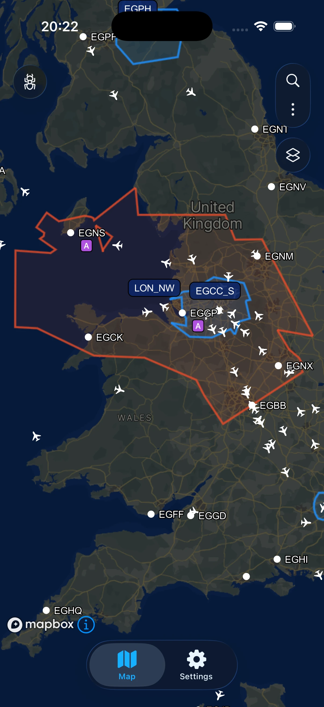
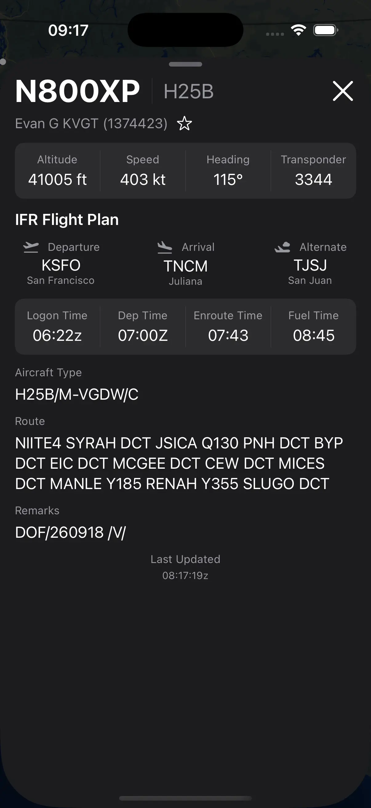
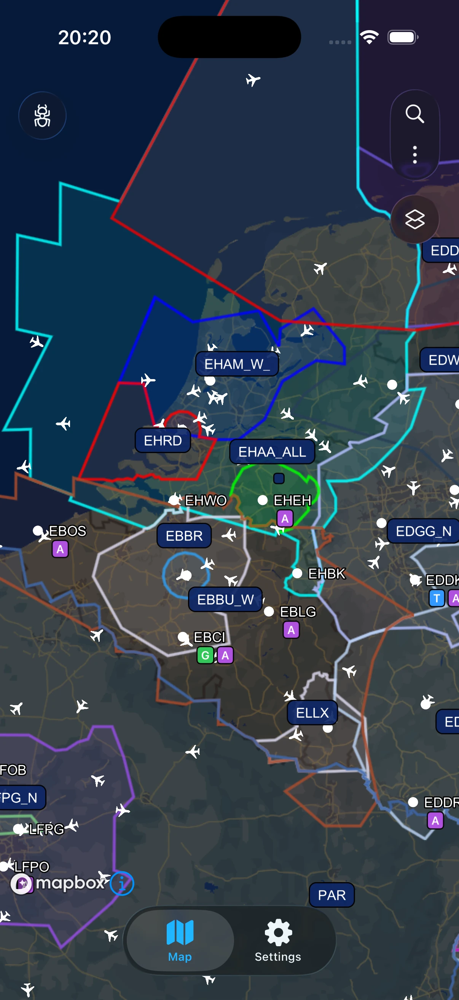
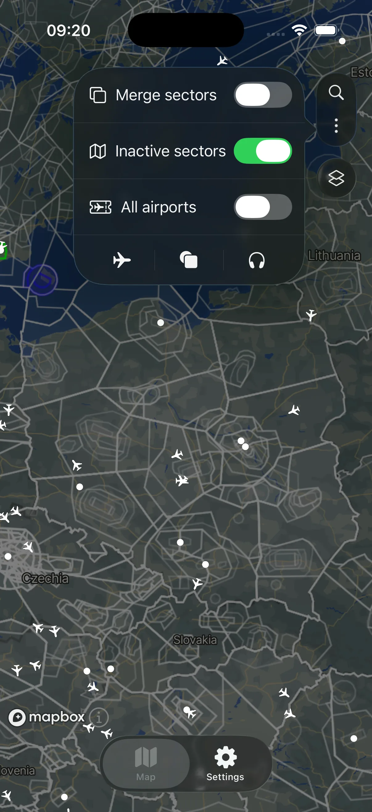
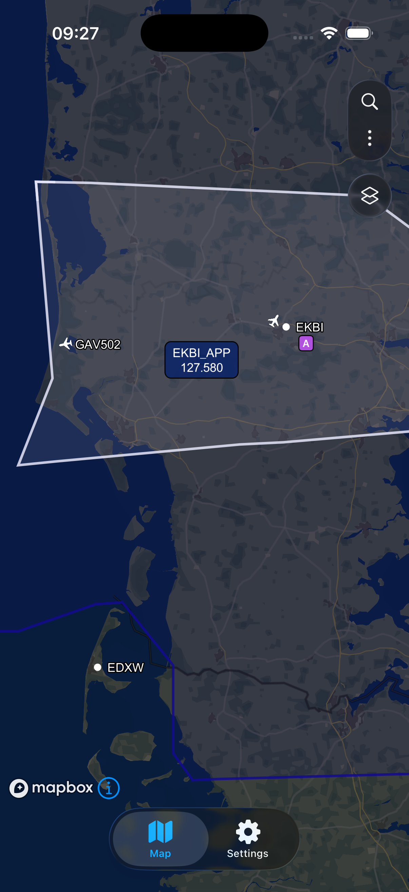
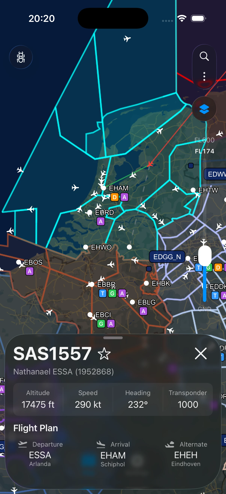
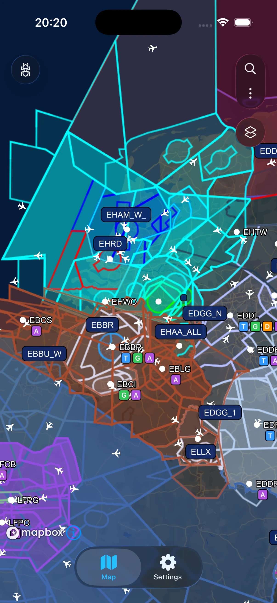
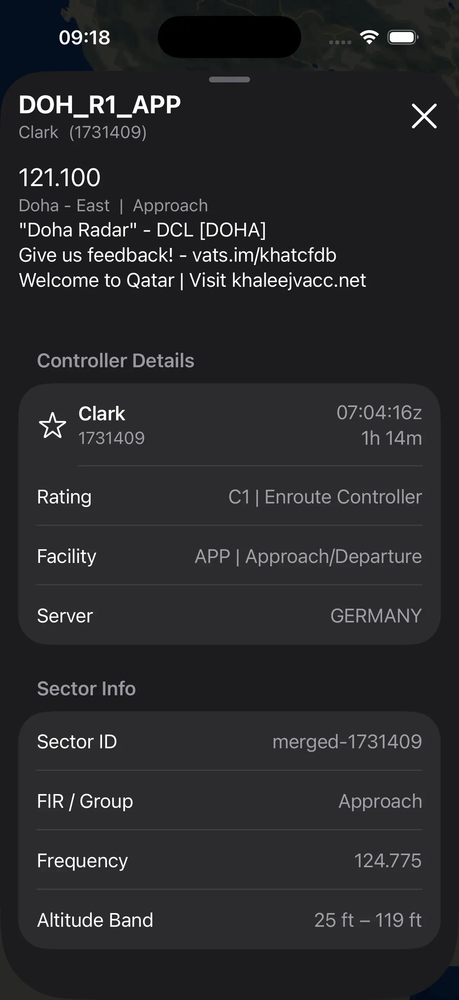
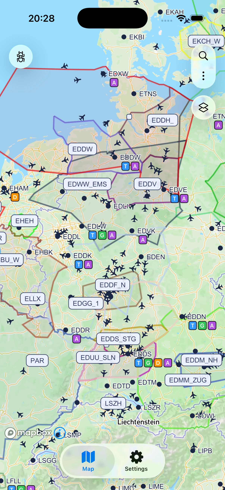

# VatSight

**The VATSIM network, live on your iPhone and iPad.**

VatSight is a free, source-available VATSIM tracker and radar map for iPhone and iPad: live traffic, VATGlasses ATC sectors and airport activity, all on one clean map.

**Website: [vatsight.com](https://vatsight.com)** · [Roadmap](https://vatsight.com/#open-source) · [Newsletter](https://vatsight.com/#newsletter)

### Features

**Live radar**
* Every pilot and controller on the VATSIM network, updated in real time on a smooth, interactive map
* More detail appears the further you zoom in

**VATGlasses ATC sectors**
* Live airspace boundaries for each online controller, powered by VATGlasses
* Merge overlapping sectors into a single outline
* Filter sectors by altitude, or show inactive sectors as well
* Tap any sector for its ownership hierarchy and controller details

**Full flight details**
* Tap any aircraft for altitude, speed, heading, squawk and the complete filed flight plan
* Show a selected flight's route and only the sectors relevant to it

**Airports and search**
* Active controllers, current traffic and the latest ATIS for every airport on the network
* Jump straight to any callsign, airport or controller in seconds

**Friends and your own flight**
* Enter your VATSIM CID to highlight your own aircraft and controlled airports
* Add friends to spot them instantly on the map

**Your map, your way**
* Dark and light mode, map styles and adjustable icon sizes
* Haptics and accessibility settings

**Privacy first**
* No account or sign-in required, and no analytics
* Optional ads to support development: off by default, and they never lock or unlock a feature

### Screenshots

### Source-available
I believe in the power of community-driven projects, so VatSight is **source-available**, meaning:

* ✅ You can view and scrutinise my work!
* ✅ You can contribute improvements!
* ❌ You cannot redistribute or sell it as a competing app!

Please share your thoughts and feedback in the repo's Issues / Discussions.

See [LICENSE](./LICENSE)

### Want to help out?
Contributions are welcome and appreciated.
You can help by:

* Fixing bugs
* Improving performance
* Enhancing UI/UX
* Suggesting new features

See [CONTRIBUTING.md](./CONTRIBUTING.md)

### Building it yourself
The app needs an `ios_app/Secrets.xcconfig` file (gitignored) containing `MAPBOX_ACCESS_TOKEN`. The AdMob IDs (`ADMOB_APP_ID`, `ADMOB_NATIVE_UNIT_ID`, `ADMOB_REWARDED_UNIT_ID`, `ADMOB_APP_OPEN_UNIT_ID`) are optional. Without them, ads are disabled in that build. Debug builds always use Google's test ads.

### Tech Stack
* Swift / SwiftUI / SwiftData
* Mapbox Maps SDK for iOS
* GEOSwift and ZIPFoundation
* Google Mobile Ads SDK (optional ads only)
* VATSIM Data API
* VATGlasses sector data

### AI Assistance
Parts of VatSight were developed with the help of generative AI tools (e.g. Claude). All code is reviewed, tested and maintained by [@MarcelMarzec](https://github.com/MarcelMarzec).

### Acknowledgements
* User data sourced from the VATSIM API
* Airspace data sourced from VATGlasses
* VatSight is an independent project and is **not affiliated with or endorsed by VATSIM**.

### Support the Project
If you find VatSight useful:

* [Sponsor on GitHub](https://github.com/sponsors/MarcelMarzec)
* Turn on optional ads in the app (Settings → Support VatSight)
* Share it with the community
* Contribute or provide feedback
* Star the repository ⭐
